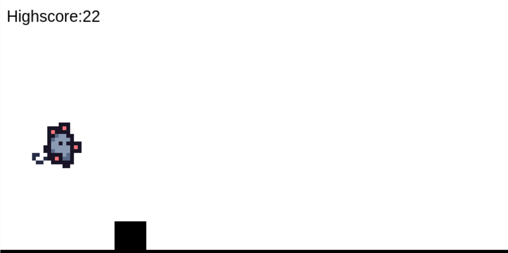

# Mauser

A (tiny) 2D EndlessRunner :^

## Showcase

## Try it out

[**Play Mauser**](https://dahmaus.github.io/Mauser)

## Run locally

1. Clone this repo :^
2. Open `index.html` in your browser <:
3. Play Mauser! :D

## AI disclosure

Minimal use, used only sometimes for debugging. Super spaghetti code as I did it lmao

## Credits

Made by me, dahmaus :D

Written in HTML, CSS and JavaScript with love <3
